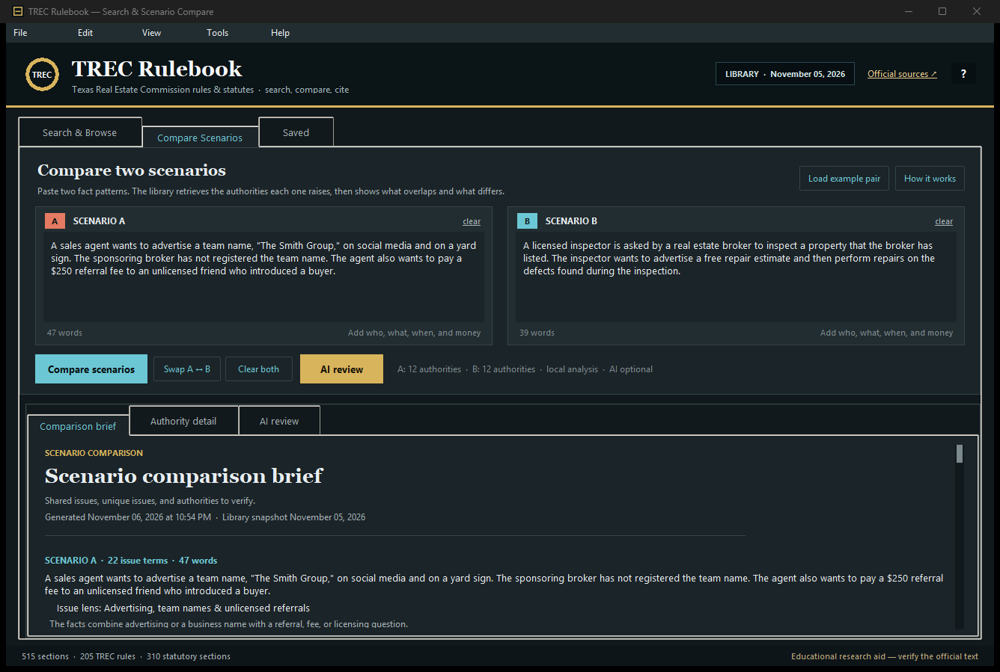

# TREC Rulebook — Searchable Texas Real Estate Commission Rules & Laws

A free Windows desktop app for searching **Texas Real Estate Commission (TREC) rules** and the **Texas real estate statutes** TREC links from its Rules and Laws page. Find a rule by keyword or section number, compare two fact patterns, copy a citation, and jump to the official source.

[**Download the latest Windows release**](https://github.com/ElizabethM-Rawr/TrecRulebook/releases/latest) · [**Browse the project site**](https://elizabethm-rawr.github.io/TrecRulebook/) · [**View the source**](https://github.com/ElizabethM-Rawr/TrecRulebook)

[](https://github.com/ElizabethM-Rawr/TrecRulebook/releases/latest)
[](https://github.com/ElizabethM-Rawr/TrecRulebook/releases/latest)
[](https://www.python.org/)
[](requirements.txt)

It gives you three things in one window:

1. **Instant search** across 515 sections of TREC rules and Texas statutes, with citations, official links, and in-document highlighting.
2. **Scenario comparison** — paste two fact patterns and get a brief showing shared issues, unique issues, the authorities each one raises, and requirement-style sentences to verify.
3. **Optional AI review** — a severity-ranked second opinion with red flags, key differences, missing facts, and a citation check.
4. **Light and dark appearance** — switch at runtime; the choice is remembered.
5. **Saved authorities and notes** for building your own research set.

Everything needed for search and comparison runs offline after the library is
downloaded. AI review defaults to the Gemini free tier when a Gemini key is
configured (otherwise the free local account), but it never runs until you ask;
only the two scenarios and the retrieved authority text go to the provider you
choose.


> Educational research aid only, not legal advice. The Texas Secretary of State maintains the official text of agency rules; the Texas Legislature maintains the official statutes. Verify every citation against the official source before relying on it.

---

## Download for Windows

Get the newest build from **[GitHub Releases](https://github.com/ElizabethM-Rawr/TrecRulebook/releases/latest)**:

- **Portable ZIP** — recommended; unzip the folder and run `TRECRulebook\TRECRulebook.exe`. Keep `_internal` next to it. No installer.
- **Single EXE** — available in the v1.4.0 release and reproducible with `build_exe.bat`; Windows may show a SmartScreen warning for a new unsigned build.

The app is free, requires no account, and includes the full 515-section library.

## What is TREC Rulebook?

TREC Rulebook is a local research tool for Texas real estate professionals, inspectors, educators, and anyone who needs to check the **Texas Administrative Code** rules for the Texas Real Estate Commission. It is designed for questions such as:

- What does TREC require for advertising a team name or assumed business name?
- How must a broker handle trust money and earnest money?
- What are the disclosure requirements for the Information About Brokerage Services (IABS) notice?
- When may a real estate inspector not act in a dual capacity or perform repairs?
- What does the Texas Timeshare Act require for registration, escrow, or cancellation?
- Which rule or statute applies to a particular fact pattern?

The search covers the TREC rules page (22 TAC chapters 531–543), the **Real Estate License Act** (Texas Occupations Code chapter 1101), the **Inspector Act** (chapter 1102), TREC's **self-directed status** statute (chapter 1105), the **Timeshare Act** (Texas Property Code chapter 221), and **Occupations Code chapter 53** as related licensing law.

---

## Quick start (Windows)

**Option 1 — double-click**

Run `start.bat`. It uses a built EXE if one exists, otherwise it launches the Python source with `pyw`/`pythonw` so no console window stays open.

`run_trec_rulebook.bat` is kept as a compatibility alias for `start.bat`.

**Option 2 — terminal**

```powershell
cd TrecRulebook
python app.py
```

Requirements: **Python 3.10 or newer with Tkinter**. The official Windows Python installer includes Tkinter; no `pip install` is needed.

If the library file is missing, the app will tell you to run:

```powershell
python tools/build_library.py
```

---

## Build a Windows EXE

Double-click `build_exe.bat`, or run:

```powershell
build_exe.bat
```

The first build checks PyInstaller and installs it for your Python if needed, bundles the data file, and writes:

```text
dist\TRECRulebook.exe
```

Subsequent builds reuse that installation. The script checks for Python 3.10+, keeps the build in `build/`, and pauses on failure so you can read the error. After a successful build, `start.bat` automatically prefers the EXE.

For a one-folder build (faster startup, easier to inspect):

```powershell
build_exe.bat onedir
```

That writes `dist\TRECRulebook\TRECRulebook.exe`.

The build machine needs internet access the first time so PyInstaller can be installed. The resulting EXE runs offline for search and comparison; AI review uses the provider you configure.

---

## What is in the library

| Source | Sections |
|---|---:|
| TREC Rules (22 TAC, chapters 531–543) | 205 |
| Tex. Occ. Code ch. 1101 — Real Estate License Act (TRELA) | 164 |
| Tex. Occ. Code ch. 1102 — Real Estate Inspectors | 50 |
| Tex. Occ. Code ch. 1105 — TREC self-directed status | 12 |
| Tex. Prop. Code ch. 221 — Timeshare Plans | 62 |
| Tex. Occ. Code ch. 53 — Consequences of Criminal Conviction *(related licensing law)* | 22 |
| **Total** | **515** |

Snapshot in this copy: **November 05, 2026**. The four TREC statute chapters (1101, 1102, 1105, and Property Code 221) are included in full; chapter 53 is included as related licensing law because TREC’s Chapter 541 rules implement it.

The data comes from:

- [TREC Rules](https://www.trec.texas.gov/agency-information/rules-and-laws/trec-rules)
- [TREC Rules and Laws](https://www.trec.texas.gov/rules-and-laws)
- [Texas Occupations Code ch. 1101](https://statutes.capitol.texas.gov/Docs/OC/htm/OC.1101.htm)
- [Texas Occupations Code ch. 1102](https://statutes.capitol.texas.gov/Docs/OC/htm/OC.1102.htm)
- [Texas Occupations Code ch. 1105](https://statutes.capitol.texas.gov/Docs/OC/htm/OC.1105.htm)
- [Texas Property Code ch. 221](https://statutes.capitol.texas.gov/Docs/PR/htm/PR.221.htm)
- [Texas Occupations Code ch. 53](https://statutes.capitol.texas.gov/Docs/OC/htm/OC.53.htm)

The rules page is a courtesy copy. The official rule text is maintained by the Texas Secretary of State in the Texas Administrative Code.

---

## Using the app

### Search & Browse

- Type a phrase, a section number (`535.155`), or a concept (`trust money`, `IABS`, `dual capacity`).
- Quote a phrase to search it exactly: `"team name"`.
- Filter by **TREC Rules**, **Statutes**, or a specific chapter.
- Select a result to read the full text. Query terms are highlighted.
- Use **Copy citation**, **Copy text**, **Open official source ↗**, or **☆ Save**.

Keyboard: `Ctrl+F` search, `↓` move into results, `Enter` open, `Esc` clear.

Search is SQLite **FTS5** with BM25 ranking and a light title/tag boost. All 515 sections are in an in-memory index, so results are immediate.

### Compare Scenarios

Paste a fact pattern into each box and choose **Compare scenarios**. The app retrieves up to 12 authorities per scenario and builds a brief with:

- recognized issues (advertising, trust funds, inspections, conflicts, etc.);
- issue lenses (transparent combinations of facts that surface decisive short sections);
- shared issues and authorities;
- A-only and B-only authorities;
- requirement-style sentences to verify;
- extracted **deadline and periodic-trigger** sentences;
- extracted **possible consequences**, grouped as license status, administrative penalty, criminal, civil, recovery fund, or other;
- **facts to confirm** before applying a rule;
- citations and relative match scores.

Scores are **relative to the best match in that scenario**, not probabilities and not legal conclusions. A lower-scored section can still be important; read the text.

The comparison is deterministic, local retrieval. It uses concept vocabulary, everyday-word synonyms, and a citation graph that lifts sections cross-referenced by highly ranked authorities. It still does not understand every fact pattern the way a lawyer would. Treat the brief as a starting index, not an answer.

The deadline and consequence sections **extract language, not legal conclusions**. They do not decide which deadline, right, or penalty applies. Confirm the triggering event, counting rule, and operative facts against the official text.

### AI review (optional)

The **AI review** tab is a second opinion on the same comparison. It asks a model to read both scenarios and the retrieved authorities, then returns:

- a short verdict and an overall risk level;
- **red flags**, ordered by severity (high / medium / low), each tied to a scenario, a citation, and a concrete fact to check;
- **key differences** that change which authority matters;
- **missing facts** that would change the answer;
- **retrieval notes** when an authority seems absent or only tangential;
- a **citation check**: any citation the model returns that is not one of the comparison's authorities is flagged (and a retrieved-but-not-included section is labelled separately).

AI review defaults to the **Gemini free tier** when a Gemini key is configured. With no Gemini key it falls back to the free local account (DeepSeek Harness, then Claude Code). It never runs until you choose **Run AI review**. Change or disable it in **Tools → AI review → AI review settings**. Six transports are available:

| Mode | What it needs | What it does |
|---|---|---|
| **Google Gemini API (free tier)** | A Gemini API key (typed or `GEMINI_API_KEY`). Default model `gemini-3.5-flash`. | Calls `generateContent` with `x-goog-api-key` and JSON response mode. If the run reports `SERVICE_DISABLED`, enable the Gemini API for the key's Cloud project or create a free AI Studio key. |
| **DeepSeek Harness (local account)** | A working DeepSeek Harness install. If you are signed in, the app reuses that account through a small generated profile overlay (`%APPDATA%\TRECRulesExplorer\ai_headless_account.patch.yml`). Otherwise it uses `DEEPSEEK_API_KEY` from the environment or `%USERPROFILE%\.dsh\.env`. | Runs `dsh --profile headless` with the prompt on stdin and validates the JSON answer. Set **Review effort** to `low` (default), `high`, or `max`. |
| **Claude Code (local CLI)** | The `claude` CLI, signed in. The app also checks `%APPDATA%\npm\claude.cmd`; you can set `CLAUDE_CODE_COMMAND`. | Runs `claude -p --output-format json --tools ""` with the prompt on stdin, disables built-in tools, and reads the `result` field. An optional model name can be set. |
| **OpenAI-compatible API** | A base URL, model, and API key (typed in settings or read from the environment variable you name). | Calls `/chat/completions` with an optional JSON response format. Works with DeepSeek, OpenAI, Ollama, LM Studio, or a gateway. |
| **Anthropic Claude API** | An Anthropic API key (typed or from `ANTHROPIC_API_KEY`). | Calls the Messages API (`/v1/messages`) with `x-api-key` and `anthropic-version`. The model defaults to `claude-sonnet-4-5` and is editable. |
| **Manual (any chat)** | Nothing. | **Copy AI prompt** puts the full prompt on the clipboard; **Import AI response** validates a pasted or loaded JSON answer. The app makes no network call. |

Keyboard: `Ctrl+Shift+A` runs the configured review. While it runs, the AI tab shows elapsed seconds and the timeout, and **Cancel** stops the process tree. The review is saved only in the session; use **Export review .md** or **Copy review** to keep it. The comparison export includes the AI review when one is present.

**Cost.** The Gemini free tier and the local-account modes do not use a paid API key from this app. Gemini free-tier quotas and rate limits apply. The DeepSeek Harness overlay defaults to `reasoningEffort: low` to keep the review short; raise it in settings for a deeper pass. Other API modes bill the endpoint you choose.

**Privacy.** Local search and the deterministic comparison never send scenario text anywhere. AI review sends both scenarios and the retrieved authority text to the provider you configure. The manual mode never contacts a provider from the app. Do not run AI review on material you cannot share with that provider.

**Not legal advice.** The model can be wrong, can miss a relevant section, and can state a rule too broadly. The citation check catches invented or out-of-packet citations, not bad reasoning. Read the cited text and verify the official source.

### Agent and CLI workflow

The same packet can be produced and answered outside the app. This is useful for an agent that can read local files, for a batch job, or for a model that is not wired into the app:

```powershell
# 1. Build the request packet from two scenario files
python -m trec_explorer.ai_cli packet --a-file a.txt --b-file b.txt --out packet.json

# 2. An agent or model answers with the JSON schema in the packet
python -m trec_explorer.ai_cli review --packet packet.json --response answer.json --out review.md

# 3. Or run the configured transport directly
python -m trec_explorer.ai_cli run --packet packet.json --mode harness --out review.md
```

The packet is plain JSON: scenarios, issue overlap, deterministic pre-check signals, and the selected authorities with text. `review` validates the schema, checks citations, and renders the same Markdown the app exports. `run --mode` accepts `gemini`, `harness`, `claude-cli`, `api`, or `anthropic`.

### Appearance and dark mode



- Choose **View → Dark mode**, or press `Ctrl+Shift+D`, to switch immediately.
- The switch rebuilds the window in place and keeps the current scenarios, search, selected section, comparison, authority detail, and AI review.
- The choice is saved in `%APPDATA%\TRECRulesExplorer\settings.json` and applied on the next start.
- To preview a theme for one run: `python app.py --theme dark` (or `--theme light`). The default on a fresh install is light.

### Saved

Bookmarks and notes are stored locally:

- `%APPDATA%\TRECRulesExplorer\bookmarks.json` on Windows when available.
- `~\.trec_rules_explorer\bookmarks.json` if `%APPDATA%` is not writable.
- A `bookmarks.local.json` file next to the library as a final fallback.

---

## Refreshing the library

The app checks the public sources in the background on startup, at most once every 24 hours, when a network connection is available. If the text changed, it downloads and parses the new version into:

```text
%APPDATA%\TRECRulesExplorer\trec_library.json
```

Use **Tools → Reload updated library** to apply it immediately; otherwise the updated library is used on the next start. **Tools → Check for rule updates now** forces a check. The bundled library is never overwritten.

For a source build or a manual refresh:

```powershell
python tools/build_library.py
```

The builder uses only the Python standard library, respects the public pages, and writes `data/trec_library.json`. It refuses to write a library with fewer than 150 rule sections, so a failed or blocked download cannot silently replace a good snapshot.

---

## Tests

```powershell
python -m unittest discover -s tests -v
python app.py --smoke-test
```

The test suite checks source counts, citation search, phrase search, filters, scenario ranking, related-authority links, deadline/penalty extraction, comparison grouping, and text helpers. The AI tests cover packet construction, deterministic pre-check signals, JSON parsing and schema validation, citation checks, harness command handling, process timeout/cancel behavior, the API client against a local mock server, and the CLI round trip.

---

## Project layout

```
trec_rules_explorer/
  app.py                     # launcher
  start.bat                  # preferred double-click launcher
  run_trec_rulebook.bat      # compatibility alias for start.bat
  build_exe.bat              # PyInstaller build script (one-file by default)
  requirements.txt           # intentionally no third-party packages
  data/
    trec_library.json        # bundled snapshot (515 sections)
  trec_explorer/
    __init__.py
    ai.py                    # optional review: packet, prompt, providers, validation
    ai_cli.py                # packet / review / run commands for agents and scripts
    engine.py                # load, FTS5 search, scenario retrieval/compare
    ingest.py                # shared fetch/parse/build pipeline
    lexicon.py               # issue vocabulary, synonyms, and issue lenses
    storage.py               # app-data paths and atomic JSON writes
    ui.py                    # Tkinter interface, bookmarks, notes, export
    updates.py               # 24-hour background source refresh
  tools/
    build_library.py         # fetch + parse + write the snapshot
    check_seo.py             # validate local landing-page metadata
    check_live.py            # verify the deployed page, sitemap, and assets
  tests/
    test_ai.py
    test_engine.py
    test_updates.py
  docs/
    index.html               # SEO landing page for GitHub Pages
    robots.txt
    sitemap.xml
    search.png
    compare.png
  README.md
```

---

## Design notes

- **No dependencies** beyond the standard library and Tkinter.
- **Offline by default**; local search and comparison never make a network call. AI review is opt-in and uses the transport you configure.
- **FTS5** handles search ranking; scenario retrieval adds issue vocabulary, IDF-weighted coverage, and short issue lenses so a long standards-of-practice section does not bury a decisive statute.
- **Citations** are preserved on every section. The detail view always links to the official source.
- **AI output is checked, not trusted**: the answer must match a small JSON schema, and citations that are not in the comparison are flagged rather than displayed as authority.
- **Bookmarks** are plain JSON, portable between machines.

---

## Frequently asked questions

### What is TREC Rulebook?

TREC Rulebook is a free, local Windows app for searching the Texas Real Estate Commission rules and the statutes TREC links from its Rules and Laws page. It combines full-text search, citations, official source links, bookmarks, notes, and side-by-side scenario comparison.

### Does it include Texas real estate laws, not just TREC rules?

Yes. It includes the Real Estate License Act (Texas Occupations Code chapter 1101), the Inspector Act (chapter 1102), TREC's self-directed status statute (chapter 1105), and the Timeshare Act (Texas Property Code chapter 221). It also includes Occupations Code chapter 53 as related licensing law, in addition to 205 TREC rule sections.

### Can I compare two scenarios?

Yes. Paste Scenario A and Scenario B into the Compare Scenarios tab. The app retrieves authorities for each, separates shared issues from unique issues, and produces a brief with citations and requirement-style sentences to verify. The optional AI review adds severity-ranked red flags and missing facts.

### Does it use AI?

Only if you turn on AI review. The default comparison is deterministic local retrieval. The AI layer defaults to the Gemini free tier when a key is configured (otherwise the free local account), never runs until you ask, and sends the scenarios and retrieved authority text only to the provider you configure. It is a second opinion, not a legal conclusion, and its citations are checked against the comparison.

### Is it free?

Yes. The app is free and the source is public. Download the Windows build from GitHub Releases; no account is required.

### Does it work offline?

Yes for search, comparison, bookmarks, and notes; the rules and statutes are bundled. AI review needs the provider you choose: the local DeepSeek Harness (which still calls its model provider), an API endpoint, or a manual copy-and-paste round trip. Local search and comparison never contact the network.

### Is there a dark mode?

Yes. Choose **View → Dark mode** or press `Ctrl+Shift+D`. The switch is immediate and keeps your current scenarios, search, comparison, and AI review. The choice is saved for the next start. `python app.py --theme dark` previews it without changing the saved setting.

### Is this legal advice?

No. It is an educational research aid. The Texas Secretary of State maintains the official rule text and the Texas Legislature maintains the statutes. Verify every citation against the official source before relying on it.

### Which TREC rule chapters are included?

The library includes 22 TAC chapters 531 (Canons of Professional Ethics and Conduct), 533 (Practice and Procedure), 534 (General Administration), 535 (General Provisions), 537 (Professional Agreements and Standard Contracts), 541 (Occupations Code chapter 53), and 543 (Timeshare Act).

---

## Limitations

- **Statute scope.** The library includes TREC's four core statute chapters (Occupations Code 1101, 1102, and 1105; Property Code 221) and Occupations Code chapter 53 as related licensing law. It does not include unrelated Texas statutes, case law, local ordinances, attorney general opinions, or agency guidance outside the TREC rules pages.
- **Freshness.** The app checks for changes at most once every 24 hours when online and stages a newer library in the user's app-data folder. A check requires a network connection; the parser can lag a very recent amendment; the official text always controls.
- **Scenario retrieval.** Retrieval is local and deterministic. Synonyms, issue lenses, and the cross-reference graph improve recall, but the app can still miss a relevant section or surface a tangential one. It does not use a legal reasoning model.
- **No legal conclusions.** The deterministic comparison extracts requirement, deadline, and consequence language and suggests facts to confirm. It does not decide rights, deadlines, penalties, or which rule controls.
- **AI review is a second opinion.** It can misread a fact, apply the wrong section, or state a rule too broadly. The schema and citation checks catch malformed output and unknown citations, not bad reasoning. It is not legal advice; read the cited text and verify the official source.
- **Not a substitute** for a Texas real estate attorney or a TREC compliance professional.
