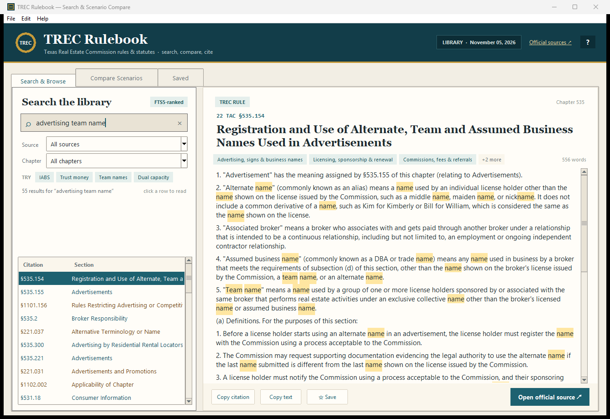
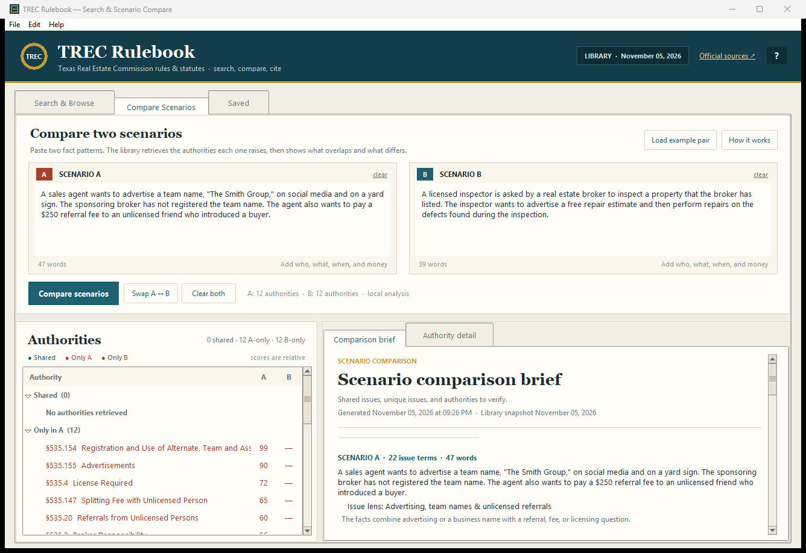

# TREC Rulebook — Searchable Texas Real Estate Commission Rules & Laws

A free Windows desktop app for searching **Texas Real Estate Commission (TREC) rules** and the **Texas real estate statutes** TREC links from its Rules and Laws page. Find a rule by keyword or section number, compare two fact patterns, copy a citation, and jump to the official source.

[**Download the latest Windows release**](https://github.com/ElizabethM-Rawr/TrecRulebook/releases/latest) · [**Browse the project site**](https://elizabethm-rawr.github.io/TrecRulebook/) · [**View the source**](https://github.com/ElizabethM-Rawr/TrecRulebook)

[](https://github.com/ElizabethM-Rawr/TrecRulebook/releases/latest)
[](https://github.com/ElizabethM-Rawr/TrecRulebook/releases/latest)
[](https://www.python.org/)
[](requirements.txt)

It gives you three things in one window:

1. **Instant search** across 481 sections of TREC rules and Texas statutes, with citations, official links, and in-document highlighting.
2. **Scenario comparison** — paste two fact patterns and get a brief showing shared issues, unique issues, the authorities each one raises, and requirement-style sentences to verify.
3. **Saved authorities and notes** for building your own research set.

Everything runs offline after the library is downloaded. There are no API keys, no model calls, and no scenario text leaves the computer.





> Educational research aid only, not legal advice. The Texas Secretary of State maintains the official text of agency rules; the Texas Legislature maintains the official statutes. Verify every citation against the official source before relying on it.

---

## Download for Windows

Get the newest build from **[GitHub Releases](https://github.com/ElizabethM-Rawr/TrecRulebook/releases/latest)**:

- **Portable ZIP** — recommended; unzip and run `TRECRulebook.exe`. No installer.
- **Single EXE** — one file; Windows may show a SmartScreen warning for a new unsigned build.

The app is free, requires no account, and includes the full 481-section library.

## What is TREC Rulebook?

TREC Rulebook is a local research tool for Texas real estate professionals, inspectors, educators, and anyone who needs to check the **Texas Administrative Code** rules for the Texas Real Estate Commission. It is designed for questions such as:

- What does TREC require for advertising a team name or assumed business name?
- How must a broker handle trust money and earnest money?
- What are the disclosure requirements for the Information About Brokerage Services (IABS) notice?
- When may a real estate inspector not act in a dual capacity or perform repairs?
- What does the Texas Timeshare Act require for registration, escrow, or cancellation?
- Which rule or statute applies to a particular fact pattern?

The search covers the TREC rules page (22 TAC chapters 531–543), the **Real Estate License Act** (Texas Occupations Code chapter 1101), the **Inspector Act** (chapter 1102), and the **Timeshare Act** (Texas Property Code chapter 221).

---

## Quick start (Windows)

**Option 1 — double-click**

Run `start.bat`. It uses a built EXE if one exists, otherwise it launches the Python source with `pyw`/`pythonw` so no console window stays open.

`run_trec_rulebook.bat` is kept as a compatibility alias for `start.bat`.

**Option 2 — terminal**

```powershell
cd trec_rules_explorer
python app.py
```

Requirements: **Python 3.10 or newer with Tkinter**. The official Windows Python installer includes Tkinter; no `pip install` is needed.

If the library file is missing, the app will tell you to run:

```powershell
python tools/build_library.py
```

---

## Build a Windows EXE

Double-click `build_exe.bat`, or run:

```powershell
build_exe.bat
```

The first build checks PyInstaller and installs it for your Python if needed, bundles the data file, and writes:

```text
dist\TRECRulebook.exe
```

Subsequent builds reuse that installation. The script checks for Python 3.10+, keeps the build in `build/`, and pauses on failure so you can read the error. After a successful build, `start.bat` automatically prefers the EXE.

For a one-folder build (faster startup, easier to inspect):

```powershell
build_exe.bat onedir
```

That writes `dist\TRECRulebook\TRECRulebook.exe`.

The build machine needs internet access the first time so PyInstaller can be installed. The resulting EXE runs offline.

---

## What is in the library

| Source | Sections |
|---|---:|
| TREC Rules (22 TAC, chapters 531–543) | 205 |
| Tex. Occ. Code ch. 1101 — Real Estate License Act (TRELA) | 164 |
| Tex. Occ. Code ch. 1102 — Real Estate Inspectors | 50 |
| Tex. Prop. Code ch. 221 — Timeshare Plans | 62 |
| **Total** | **481** |

Snapshot in this copy: **November 05, 2026**.

The data comes from:

- [TREC Rules](https://www.trec.texas.gov/agency-information/rules-and-laws/trec-rules)
- [TREC Rules and Laws](https://www.trec.texas.gov/rules-and-laws)
- [Texas Occupations Code ch. 1101](https://statutes.capitol.texas.gov/Docs/OC/htm/OC.1101.htm)
- [Texas Occupations Code ch. 1102](https://statutes.capitol.texas.gov/Docs/OC/htm/OC.1102.htm)
- [Texas Property Code ch. 221](https://statutes.capitol.texas.gov/Docs/PR/htm/PR.221.htm)

The rules page is a courtesy copy. The official rule text is maintained by the Texas Secretary of State in the Texas Administrative Code.

---

## Using the app

### Search & Browse

- Type a phrase, a section number (`535.155`), or a concept (`trust money`, `IABS`, `dual capacity`).
- Quote a phrase to search it exactly: `"team name"`.
- Filter by **TREC Rules**, **Statutes**, or a specific chapter.
- Select a result to read the full text. Query terms are highlighted.
- Use **Copy citation**, **Copy text**, **Open official source ↗**, or **☆ Save**.

Keyboard: `Ctrl+F` search, `↓` move into results, `Enter` open, `Esc` clear.

Search is SQLite **FTS5** with BM25 ranking and a light title/tag boost. All 481 sections are in an in-memory index, so results are immediate.

### Compare Scenarios

Paste a fact pattern into each box and choose **Compare scenarios**. The app retrieves up to 12 authorities per scenario and builds a brief with:

- recognized issues (advertising, trust funds, inspections, conflicts, etc.);
- issue lenses (transparent combinations of facts that surface decisive short sections);
- shared issues and authorities;
- A-only and B-only authorities;
- requirement-style sentences to verify;
- citations and relative match scores.

Scores are **relative to the best match in that scenario**, not probabilities and not legal conclusions. A lower-scored section can still be important; read the text.

The comparison is deterministic, local retrieval. It does not understand every fact pattern the way a lawyer would. Treat the brief as a starting index, not an answer.

### Saved

Bookmarks and notes are stored locally:

- `%APPDATA%\TRECRulesExplorer\bookmarks.json` on Windows when available.
- `~\.trec_rules_explorer\bookmarks.json` if `%APPDATA%` is not writable.
- A `bookmarks.local.json` file next to the library as a final fallback.

---

## Refreshing the library

When TREC or the Legislature updates a source:

```powershell
python tools/build_library.py
```

The builder uses only the Python standard library, respects the public pages, and writes `data/trec_library.json`. The app reads that file at startup.

It refuses to write a library with fewer than 150 rule sections, so a failed/blocked download cannot silently replace a good snapshot.

---

## Tests

```powershell
python -m unittest discover -s tests -v
python app.py --smoke-test
```

The test suite checks source counts, citation search, phrase search, filters, scenario ranking, comparison grouping, and text helpers.

---

## Project layout

```
trec_rules_explorer/
  app.py                     # launcher
  start.bat                  # preferred double-click launcher
  run_trec_rulebook.bat      # compatibility alias for start.bat
  build_exe.bat              # PyInstaller build script (one-file by default)
  requirements.txt           # intentionally no third-party packages
  data/
    trec_library.json        # bundled snapshot (481 sections)
  trec_explorer/
    __init__.py
    engine.py                # load, FTS5 search, scenario retrieval/compare
    lexicon.py               # issue vocabulary and issue lenses
    ui.py                    # Tkinter interface, bookmarks, notes, export
  tools/
    build_library.py         # fetch + parse + write the snapshot
  tests/
    test_engine.py
  docs/
    index.html               # SEO landing page for GitHub Pages
    robots.txt
    sitemap.xml
    search.png
    compare.png
  README.md
```

---

## Design notes

- **No dependencies** beyond the standard library and Tkinter.
- **Offline by default**; the only network operation is the explicit refresh command.
- **FTS5** handles search ranking; scenario retrieval adds issue vocabulary, IDF-weighted coverage, and short issue lenses so a long standards-of-practice section does not bury a decisive statute.
- **Citations** are preserved on every section. The detail view always links to the official source.
- **Bookmarks** are plain JSON, portable between machines.

---

## Frequently asked questions

### What is TREC Rulebook?

TREC Rulebook is a free, local Windows app for searching the Texas Real Estate Commission rules and the statutes TREC links from its Rules and Laws page. It combines full-text search, citations, official source links, bookmarks, notes, and side-by-side scenario comparison.

### Does it include Texas real estate laws, not just TREC rules?

Yes. It includes the Real Estate License Act (Texas Occupations Code chapter 1101), the Inspector Act (chapter 1102), and the Timeshare Act (Texas Property Code chapter 221), in addition to 205 TREC rule sections.

### Can I compare two scenarios?

Yes. Paste Scenario A and Scenario B into the Compare Scenarios tab. The app retrieves authorities for each, separates shared issues from unique issues, and produces a brief with citations and requirement-style sentences to verify.

### Is it free?

Yes. The app is free and the source is public. Download the Windows build from GitHub Releases; no account is required.

### Does it work offline?

Yes. The rules and statutes are bundled. Search, comparison, bookmarks, and notes work without a network connection. Official source links open in your browser when you choose them.

### Is this legal advice?

No. It is an educational research aid. The Texas Secretary of State maintains the official rule text and the Texas Legislature maintains the statutes. Verify every citation against the official source before relying on it.

### Which TREC rule chapters are included?

The library includes 22 TAC chapters 531 (Canons of Professional Ethics and Conduct), 533 (Practice and Procedure), 534 (General Administration), 535 (General Provisions), 537 (Professional Agreements and Standard Contracts), 541 (Occupations Code chapter 53), and 543 (Timeshare Act).

---

## Limitations

- Only the three statutes linked from TREC's Rules and Laws page are included. General statute chapters, case law, local ordinances, and agency guidance are outside this library.
- The text is a snapshot. Rules and statutes change; refresh before relying on a citation.
- Scenario retrieval is keyword/issue based. It can miss a relevant section or surface a tangential one.
- The comparison does not decide rights, deadlines, or penalties. Always read the full section and confirm the official text.
- This is not a substitute for a Texas real estate attorney or a TREC compliance professional.
